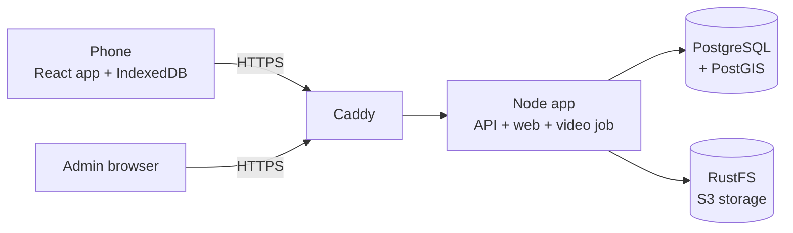

<p align="center">
  
</p>

<h1 align="center">Field Capture</h1>

A web app for collecting **video and GPS data along walking routes**. Administrators draw routes, hand them to field workers, and review what comes back. Workers follow the route on their phone, record video and GPS, and the app uploads it, even over a poor connection. The server, not the phone, decides whether the route was really completed.

It is built to be careful with the data: a recording survives a refresh or crash, uploads resume where they stopped, every chunk is checksummed, and a phone deletes its copy only after the server has verified it.

> **Status:** working end to end. The server side is covered by automated tests; the phone side was tested by the owner on phones in normal use, but has not been stress-tested (long walks, low storage, poor network) and the results are not recorded here. See [Status and limits](#status-and-limits).

## Why Field Capture?

| Feature | Fulcrum | ArcGIS Survey123 | QField + QFieldCloud | Open Foris Arena Mobile | Field Capture |
| --- | --- | --- | --- | --- | --- |
| **Cost** | 💳 From US$43/user/month | 💳 Paid ArcGIS licensing | 🆓 Free core app, optional paid cloud | 🆓 Free and open source | 🙌 No third-party per-user licensing |
| **GPS** | ✅ | ✅ Tracking | ✅ Continuous tracking | ✅ Coordinates | ✅ |
| **Synchronized video and GPS** | ✅ | ➖ | ❌ None documented | ❓ Not verified | ✅ |
| **Video length** | ⚠️ Short clips suggested in practice | ⚠️ 10 MB field-app attachment limit | ➖ | ⚠️ 99 MB limit in our test | 🔍 To be verified |
| **Offline collection** | ✅ | ✅ | ✅ | ✅ | 🔍 To be verified |
| **Centralized storage** | ✅ | ✅ | ⚠️ Limited free cloud storage | ✅ | ✅ |
| **Route-based work** | ➖ | ➖ | ✅ Route navigation | ➖ | ✅ Simple route-based recording |
| **Standardized data exports** | ➖ | ➖ | ➖ | ➖ | ✅ |
| **Getting started** | ➖ | ⚠️ Licensing and configuration complexity | ⚠️ Requires GIS setup | 📝 Form-based collection | 🏗️ Requires development and testing |

✅ supported · ⚠️ limited · ❌ not available · ❓ / 🔍 still to verify · ➖ not assessed

## What it does

**Administrators**
- Create, deactivate and delete field workers (their recorded data is kept); set their passwords (workers cannot change them).
- Draw routes on a map: required and optional segments, curved or straight, points edited on the map or typed as latitude and longitude, segment order changed by drag and drop, undo and redo.
- Publish routes as immutable **versions**; assign a version to a worker. Changing a route later makes a new version and never changes work already handed out.
- Review each assignment: the server's verdict and reasons, the recorded track on a map, the video playing with a marker that follows it, jump to any segment, approve or send back.
- Download videos, GPS data (with video-relative times) and a full export. Every view and download is audited.

**Field workers**
- Sign in, see their assignments on a map.
- A GPS check (accuracy and stability, with a recorded skip after 90 seconds), a camera and storage check.
- Record: a map with "go here next" over the live camera, in a resizable split. Skip optional segments.
- Recording is saved on the phone as it happens and uploads in the background. After a crash or reload it is recovered and finished.

**The platform**
- Server-side sessions, Argon2id passwords, role and ownership checks on every endpoint, CSRF protection, a login lockout, an audit log.
- Route versions and verified recordings are frozen by database rules, not only by the API.
- Video goes through the app into S3-compatible storage (RustFS) and is assembled into one seekable file in the background. A worker can download their own verified video and GPS from the server; nothing is exported from the phone before the server has verified it.

## How it works



1. The worker's phone records 2-second video chunks and GPS points into IndexedDB (each chunk hashed).
2. It uploads them through the app while online, asks the server what it already has, and resends only the rest.
3. When the recording ends, a **manifest** (every chunk's hash, the GPS count) is checked by the server. Only then does the phone delete its copy.
4. The server recomputes coverage from the GPS it holds and decides: `completed`, `needs_review`, `in_progress`, or `pending_sync`.
5. A background job builds one playable, seekable video from the chunks.

Read more: [Architecture](docs/development/architecture.md) and [Field flow](docs/reference/field-flow.md).

## Quick start

You need **Docker** (with Compose v2) and, for development on your machine, **Node.js 22**.

### Develop on your laptop

```bash
./scripts/init-env.sh      # or: npm run init:env
```

It creates `.env` from `.env.example` with fresh random values for `POSTGRES_PASSWORD` (also put inside `DATABASE_URL`), `S3_ACCESS_KEY` and `S3_SECRET_KEY`, and asks whether the admin password should be random or your own. Run it **before** the first start: changing `POSTGRES_PASSWORD` later does not change the password inside an existing database volume. If `.env` exists it asks first and keeps a `.env.bak`.

```bash
docker compose -f docker-compose.yml -f docker-compose.dev.yml up -d db rustfs   # database and storage, on 127.0.0.1 only
npm install
npm run dev                                                                      # http://localhost:3100
```

Sign in as `ADMIN_USERNAME` with `ADMIN_PASSWORD`. Dev mode turns on **dev tools**: on a worker's assignment page you can switch on fake GPS and a canvas camera and run the whole flow without walking. Recordings made that way are marked *simulated* and always go to review.

### Run the whole stack in Docker, for a phone, over Tailscale

A phone only allows the camera and GPS on HTTPS.

```bash
# gets the certificate and fills in TAILNET_HOST and PUBLIC_ORIGINS in .env:
./scripts/tailnet-cert.sh

docker compose --profile tailnet up -d --build
```

Open `https://<TAILNET_HOST>` on a device that is on your tailnet. Full steps, including certificate renewal: [Deployment](docs/operations/deployment.md).

### Run on a public server

Point a domain at the server, set `DOMAIN` and `PUBLIC_ORIGINS=https://<domain>` in `.env`, then:

```bash
docker compose --profile public up -d --build
```

Caddy gets a certificate automatically. Read the [security checklist](docs/reference/security.md#before-going-public-checklist) first, and never use the dev override on a server.

## First steps

1. Sign in as the admin and **change the password** (click your username).
2. **Workers**: add a worker (type a password or let the app generate one).
3. **Routes → New route**: draw a route, **Save & publish**.
4. **Assignments**: assign the published route to the worker.
5. The worker signs in on a phone, opens the assignment, passes the GPS and camera checks, and records.
6. After **Check & finish**, open the assignment as admin to review.

Guides: [Admin guide](docs/guides/admin.md), [Worker guide](docs/guides/worker.md).

## Repository layout

```
server/        Express API, completion logic, video assembler, storage, auth
  routes/        one file per area of the API
  services/      coverage and status, video assembly, downloads, storage, audit
  auth/          password hashing, sessions, the first admin
shared/        code used by both server and browser: types, thresholds, geometry,
               coverage, GPS quality, curve smoothing, GPS-check logic
web/public/    the logo (SVG), tab icon and phone home-screen icon
web/src/       React app
  admin/         admin pages, including editor/ (the route editor)
  worker/        worker pages
    lib/           phone-side recording, upload, local database, GPS, camera
db/            migrations (plain SQL) and the Postgres + PostGIS image
deploy/        Caddy configuration for the two edge profiles
test/
  unit/          pure logic, nothing else needed
  integration/   the API against real Postgres and RustFS, plus the endpoint check
  repo/          the docs and the file layout stay correct
scripts/       set up .env, the tailnet certificate, export RustFS
docs/          the documentation: guides/, operations/, reference/, development/
docker-compose.yml          db, rustfs, app, and the edge proxy profiles
docker-compose.dev.yml      laptop override: private ports on 127.0.0.1, dev tools on
```

## Commands

| Command | Does |
| --- | --- |
| `npm run dev` | rebuild the web app on change and run the server against the compose database and storage |
| `npm run build` | build the web app (`dist/web`) and bundle the server (`dist/server.js`) |
| `npm start` | run the built server |
| `npm test` | all tests (needs the database and storage up), then the endpoint check |
| `npm run test:unit` | pure-logic tests only, nothing else needed |
| `npm run test:coverage` | all tests with a coverage table |
| `npm run typecheck` | TypeScript check |
| `npm run check` | lint and formatting check (Biome), as CI runs it |
| `npm run format` | apply the formatting |
| `npm run export:storage` | export everything in RustFS to one `.tar` file |

## Configuration

Environment variables (database, storage, allowed origins, cookies, admin bootstrap, session lengths, dev tools) and the tuning constants (GPS thresholds, coverage, chunk length, bitrate) are listed in [Configuration](docs/operations/configuration.md). The example file is `.env.example`; `.env` is never committed.

## Tech stack

Node 22, Express 5, TypeScript, zod · React 19, Vite, Leaflet · PostgreSQL 18 with PostGIS · RustFS (S3-compatible) · Caddy · Argon2id · ffmpeg (video remux) · Docker Compose · `node:test` for tests.

## Testing

```bash
docker compose -f docker-compose.yml -f docker-compose.dev.yml up -d db rustfs
npm test
```

130+ tests run against a real database and real object storage (each file gets its own throw-away database and bucket). `npm test` also **fails if any API endpoint has no passing test**, so the claim "every endpoint is tested" cannot drift. Details, coverage and what is not tested: [Testing](docs/development/testing.md).

## Security at a glance

- Argon2id passwords; server-side sessions with hashed tokens in a `HttpOnly`, `Secure`, `SameSite=Lax` cookie; instant sign-out on deactivation or password change.
- Roles and ownership enforced on the server; another worker's data answers `404`.
- CSRF origin check, JSON-only bodies, CSP and other security headers, a login lockout.
- Published routes and verified recordings are immutable in the database; every chunk is checksummed on the phone and the server.
- Only the reverse proxy publishes ports; the database and storage stay private. Video is reachable only by admins and every access is audited.
- **Not protected**: a determined user with their own phone can read browser storage. See [Security](docs/reference/security.md#what-is-not-protected).

## Status and limits

Works end to end and is tested on the server side. Known limits:

- The phone code has almost no automated tests (only the retry and error-text helper, `test/unit/retry.test.ts`). The storage retry and the storage readout have not been tried on a real phone with a full disk. It was checked by hand in a desktop browser with fake GPS and camera, and by the owner on phones in normal use. Not yet stress-tested: long walks (25 minutes or more), low storage, a poor or interrupted network, several phone models. Which phones and what was found is not recorded here yet.
- No background recording (a browser limit): switching apps or locking the screen stops it.
- No offline loading of the app, no admin delete or retention, no monitoring yet.
- The free OpenStreetMap, OpenTopoMap and Esri satellite tile servers are used; use a tile provider for production.

The full list and the proposed next steps are in the [Roadmap](docs/development/roadmap.md).

## Documentation

- **Using the app:** [Admin guide](docs/guides/admin.md), [Worker guide](docs/guides/worker.md)
- **Running it:** [Deployment](docs/operations/deployment.md), [Configuration](docs/operations/configuration.md), [Runbook](docs/operations/runbook.md), [Database migration plan](docs/operations/database-migration.md)
- **How it works:** [Field flow](docs/reference/field-flow.md), [API reference](docs/reference/api.md), [Data model](docs/reference/data-model.md), [Security](docs/reference/security.md)
- **Working on the code:** [Architecture](docs/development/architecture.md), [Testing](docs/development/testing.md), [Decisions](docs/development/decisions.md), [Roadmap](docs/development/roadmap.md)

## License

Copyright © 2026 Suppakorn Krabtong. Licensed under [Creative Commons Attribution-NonCommercial 4.0 International](LICENSE) (CC BY-NC 4.0): you may share and adapt it with credit, but not for commercial purposes.
