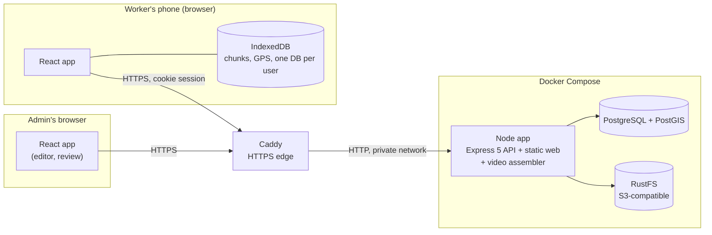
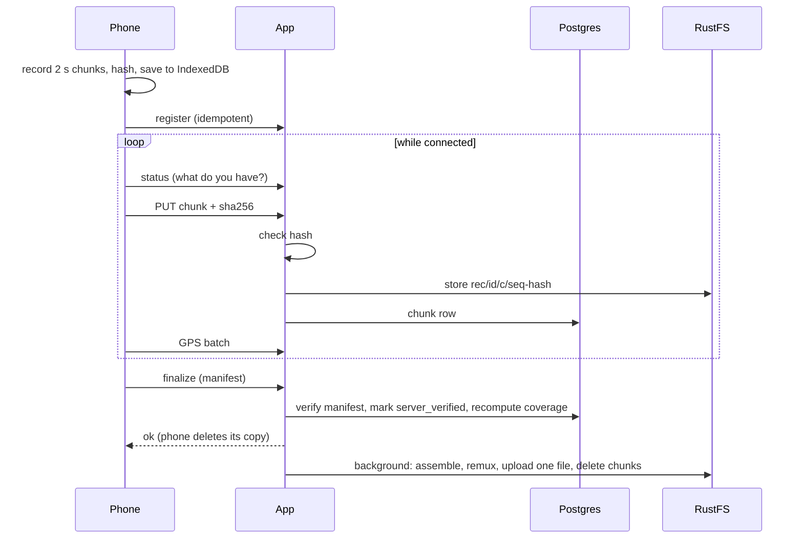

# Architecture

## The parts

| Part | Role |
| --- | --- |
| **Web app** (`web/`) | One React single-page app for both roles. Hash routing (`#/...`), so the server needs no route fallback. Leaflet maps. |
| **App server** (`server/`) | Express 5 + TypeScript. Serves the JSON API and the built web app from one process. Owns authentication, authorization, validation, completion decisions and the video assembler. |
| **PostgreSQL + PostGIS** | System of record: users, sessions, routes and versions (geometry as `geometry(LineString, 4326)`), assignments, recordings' metadata, GPS points, audit log. |
| **RustFS** | S3-compatible object storage for video: chunk objects while a recording is uploading, then one assembled file. Not reachable from outside the compose network. |
| **Caddy** | The only published ports. Terminates TLS (Tailscale certificate files, or Let's Encrypt on a public host) and proxies to the app. The app itself speaks plain HTTP inside the private network. |
| **Shared code** (`shared/`) | TypeScript used by both sides so they always agree: types, thresholds, geometry and coverage maths, curve smoothing, GPS-check logic. |

## Why one server process

The workload is small (a handful of workers, short bursts of uploads). One process serving API, static files and a background job keeps deployment to a single image and avoids a message queue. The video assembler is a loop inside the app that claims jobs from Postgres (`FOR UPDATE SKIP LOCKED`), so a second instance would not double-process, and a crash is recovered on the next start. See [decisions](decisions.md).

## Request path

1. The browser calls `https://host/api/...`. Caddy forwards to `app:3100` and sets `X-Forwarded-*`; the app trusts one proxy hop (`TRUST_PROXY=1`), which is what makes `Secure` cookies and client IPs work.
2. `helmet` adds security headers (CSP, HSTS when `COOKIE_SECURE`, `Referrer-Policy`).
3. For `/api`: `Cache-Control: no-store` → CSRF guard → session lookup (`attachUser`) → the router's guards (`requireAuth`, `requireRole`) → the handler.
4. Handlers validate input with zod, run SQL through `pg`, and write an audit row for anything sensitive. Errors become JSON through one error handler (`server/http.ts`).

The mount table in `server/app.ts` (`MOUNTS`) is the single list of routers and their guards; tests read the same table to check endpoint coverage.

## Server modules

| File | What it does |
| --- | --- |
| `index.ts` | Start-up order: config check → migrations → bootstrap admin → ensure bucket → start assembler → listen. |
| `app.ts` | Builds the Express app; `MOUNTS`; `listEndpoints()`. |
| `config.ts` | Reads environment variables once. |
| `db.ts`, `migrate.ts` | `pg` pool and helpers; plain-SQL migrations from `db/migrations`, applied once each under an advisory lock. |
| `http.ts` | `HttpError`, CSRF guard, session middleware, role guards, error handler. |
| `auth/password.ts`, `auth/sessions.ts` | Argon2id hashing; hashed-token sessions. |
| `bootstrap.ts` | Creates the first admin from the environment, only if no admin exists. |
| `routes/*.ts` | One file per area; see [API](api.md). |
| `evaluate.ts` | Recomputes segment coverage and decides assignment status from the GPS the server holds. |
| `assemble.ts` | Builds the playable video after a recording is verified. |
| `storage.ts` | S3 client: bucket, put/get/delete, multipart. |
| `audit.ts` | Writes `audit_log` rows. |

## Web modules

| Path | What it does |
| --- | --- |
| `main.tsx` | Router, role-based shell, error boundary. |
| `auth.tsx` | Session context, login, admin password change, the "signed out while recording" banner. |
| `admin.tsx` | Workers, routes and versions list, assignments. |
| `RouteEditor.tsx`, `editor/` | The route editor: map, segment list, points table, edit model (pure functions with undo/redo). |
| `Review.tsx` | Admin review of an assignment: map, video, evidence, downloads, approve/send back, audit. |
| `worker.tsx`, `worker/RunPage.tsx`, `worker/Onboard.tsx` | A worker's list, the assignment home page (map, segments, recordings, finish) and its onboard sub-page (GPS, then camera and storage). |
| `worker/RecordingView.tsx` | The full-screen split view while recording: map on top, live camera below. |
| `worker/recorder.ts`, `uploader.ts`, `localdb.ts`, `gps.ts`, `camera.ts`, `session.ts`, `settings.ts` | The phone-side machinery; see [field flow](field-flow.md). |

## Build and run

- `npm run build`: `vite build` writes the web app to `dist/web`; `esbuild` bundles the server to `dist/server.js` (npm packages stay external).
- The Docker image has two stages: build (full `npm ci`, build) and run (`npm ci --omit=dev`, the bundle, the migrations, and **ffmpeg**). It runs as the non-root `node` user.
- Dev: `npm run dev` rebuilds the web app on change and restarts the server (`tsx watch`) against the compose database and RustFS.

## Data flow of a recording (summary)

Details and failure handling are in [field flow](field-flow.md).
