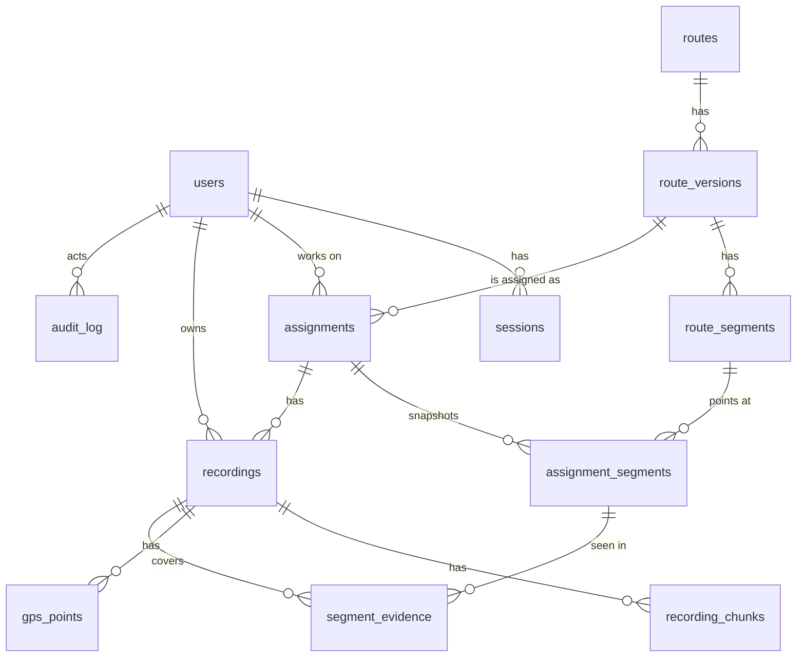
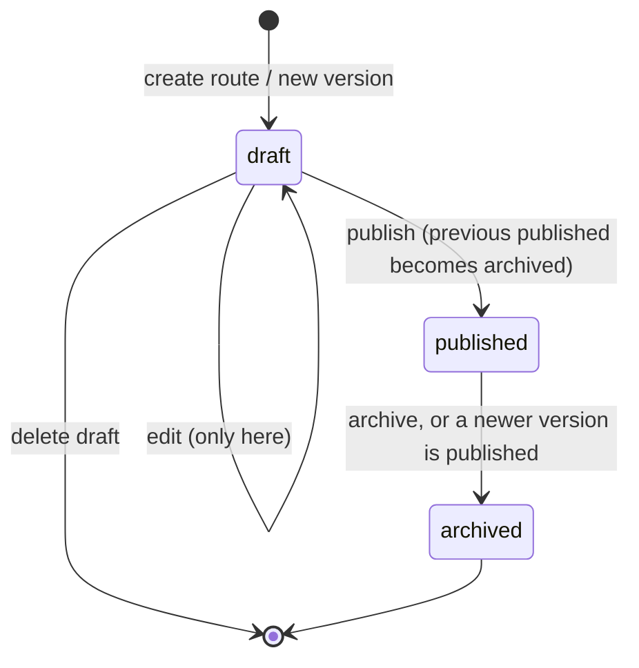
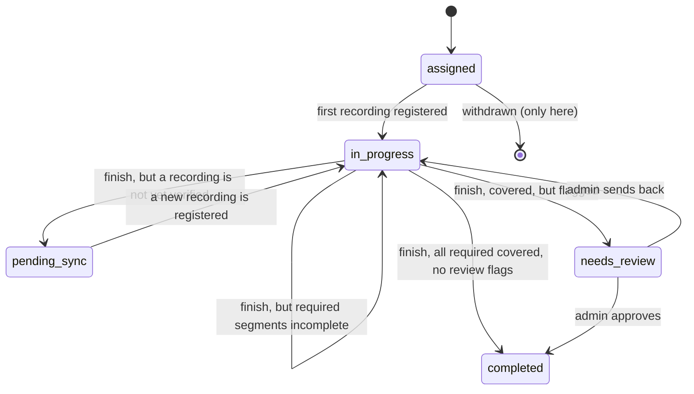

# Data model

PostgreSQL 17 with PostGIS. Schema changes are plain SQL files in `db/migrations`, applied in name order, once each, under an advisory lock at start-up. They only go forward: to roll back, restore a backup (see [operations](operations.md#backup-and-restore)).

| Migration | Adds |
| --- | --- |
| `001_init.sql` | users, sessions, login attempts, routes, route versions and segments, assignments and their segments, audit log, and the guard triggers |
| `002_version_names.sql` | a name per route version (so renaming a draft cannot change a published version) |
| `003_simple_workers_curves.sql` | curve control points on segments; drops the assignment note and the forced-password-change flag |
| `004_recordings.sql` | recordings, chunks, GPS points, segment evidence, assignment progress columns, more guard triggers |

## Entity overview

## Tables

### Accounts

**`users`**: `id`, `username` (unique, `^[a-z0-9._-]{3,32}$`), `display_name`, `password_hash` (Argon2id), `role` (`admin` or `worker`), `active`, `password_changed_at`, timestamps. There is no admin-creates-admin feature; the first admin comes from the environment.

**`sessions`**: `id` is the **SHA-256 of the cookie token** (a database leak does not leak live sessions), `user_id` (cascade delete), `expires_at`, `last_seen_at`, `ip`, `user_agent`. Deleting a user's rows signs them out at once.

**`login_attempts`**: failed logins (`username`, `ip`, `at`) for the lockout. Cleared for a user after a successful login; rows older than a day are pruned.

### Routes (templates, versioned)

**`routes`**: `id`, `name` (follows the latest published version), `created_by`.

**`route_versions`**: `route_id`, `version` (unique per route), `name`, `status` (`draft`, `published`, `archived`), `published_at`. Partial unique indexes allow **one draft and one published version per route**.

**`route_segments`**: `route_version_id`, `ord` (walking order), `name`, `required`, `geom geometry(LineString, 4326)` (GiST indexed), `control jsonb` (the points the admin placed, for curved segments; `NULL` for straight ones), `min_coverage_ratio` (0.5 to 1, default 0.9). For a curved segment `geom` is the smooth curve the server drew from `control`.

### Work

**`assignments`**: `route_version_id` (restrict delete), `user_id`, `assigned_by`, `status`, `preflight jsonb`, `quality jsonb`, `review_reasons jsonb`, `completed_at`. Created only for a **published** version and a **worker**.

**`assignment_segments`**: one row per segment at assignment time: `route_segment_id`, `ord`, `required` (copied), `status` (`pending`, `in_progress`, `completed`, `skipped`), `skip_reason`, `coverage`, `completed_at`. A check constraint makes `skipped` impossible when `required`.

**`recordings`**: `id` (a UUID made on the phone, so registering twice is harmless), `assignment_id`, `user_id` (kept here so every worker query can be scoped without a join), `mime`, `status` (`open`, `server_verified`), `simulated`, `started_at_ms` (video t = 0), `ended_at_ms`, `stop_reason`, `chunk_count`, `gps_count`, `verified_at`, and the video build: `assembly_state` (`none`, `pending`, `running`, `done`, `failed`), `assembly_error`, `file_key`, `file_bytes`, `file_sha256`, `file_mime`, `chunks_purged`.

**`recording_chunks`**: `(recording_id, seq)`, `sha256`, `size`, `object_key`. The rows stay after the chunk objects are deleted: they are the record of what the video was built from.

**`gps_points`**: `(recording_id, seq)`, `t_ms`, `lat`, `lng`, `acc`. Imperfect points are never dropped, only flagged by the evaluation.

**`segment_evidence`**: for each segment and recording that touched it: `coverage`, `first_t_ms`, `last_t_ms`. The review page uses it to jump the video to a segment.

### Audit

**`audit_log`**: `at`, `actor_id`, `action`, `target_type`, `target_id`, `details jsonb`, `ip`. Actions written: `admin_bootstrapped`, `login`, `login_failed`, `login_locked`, `logout`, `password_changed`, `password_set`, `user_created`, `user_updated`, `user_activated`, `user_deactivated`, `route_created`, `route_draft_saved`, `route_draft_deleted`, `route_version_created`, `route_published`, `route_archived`, `assignment_created`, `assignment_withdrawn`, `assignment_evaluated`, `assignment_reviewed`, `assignment_exported`, `preflight`, `segment_skipped`, `segment_unskipped`, `recording_registered`, `recording_verified`, `recording_verify_failed`, `recording_discarded`, `recording_assembled`, `recording_assembly_failed`, `recording_viewed`, `recording_downloaded`, `gps_downloaded`.

## Rules the database enforces itself

These hold even for code that bypasses the API (the tests try raw SQL against each).

| Trigger / constraint | Rule |
| --- | --- |
| `route_versions_guard` | A published or archived version's identity and name never change; archived never reopens; published never goes back to draft; only drafts can be deleted. |
| `route_segments_guard` | Segments of a published or archived version cannot be inserted, changed or deleted. |
| `assignments_guard` | Only a published version can be assigned, only to a worker; an assignment keeps its version and worker. |
| `skipped_only_if_optional` | A required segment can never be `skipped`. |
| `recordings_guard` | A recording keeps its id, assignment and owner; once verified, its chunk and GPS counts, start time, mime and `simulated` flag are frozen. |
| `gps_points_guard`, `recording_chunks_guard` | No GPS or chunk rows can be added to or changed on a verified recording. |
| unique indexes | one draft and one published version per route; usernames unique. |

## Route versions

"Edit" on a published route means **new version**: the latest version is copied into a fresh draft. Existing assignments stay on the version they were given, with the segments they were given.

## Assignment status

Segment status: `pending` → `in_progress` (some coverage) → `completed` (coverage at or above the segment's minimum); optional segments can be `skipped` (and un-skipped). The decision rules are in [field flow](field-flow.md#how-the-server-decides).

## Recording status

On the server a recording is `open` until its manifest is verified, then `server_verified` and frozen. The phone tracks finer states (`recording`, `interrupted`, `pending_upload`, `uploading`, `upload_interrupted`, `server_verified`) in IndexedDB; they are kept separate on purpose: a finished recording is not uploaded, and an uploaded one does not mean the assignment is complete.

## Object storage layout

| Key | Content |
| --- | --- |
| `rec/<recordingId>/c/<seq>-<sha256>` | one chunk. The hash is part of the key, so two racing uploads of the same `seq` can never overwrite each other. Deleted after a good build. |
| `rec/<recordingId>/video.webm` or `.mp4` | the assembled, remuxed video. Kept until an admin deletes it (no automatic retention). |

One bucket (`S3_BUCKET`, default `recordings`), created at start-up if missing.
