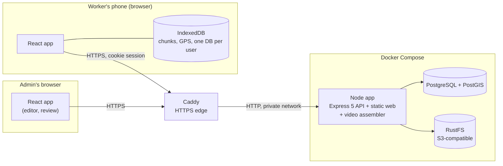
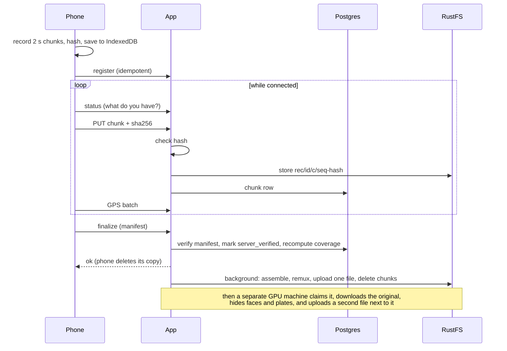

# Architecture

## The parts

| Part | Role |
| --- | --- |
| **Web app** (`web/`) | One React single-page app for both roles. Hash routing (`#/...`), so the server needs no route fallback. Leaflet maps. |
| **App server** (`server/`) | Express 5 + TypeScript. Serves the JSON API and the built web app from one process. Owns authentication, authorization, validation, completion decisions and the video assembler. |
| **PostgreSQL + PostGIS** | System of record: users, sessions, routes and versions (geometry as `geometry(LineString, 4326)`), assignments, recordings' metadata, GPS points, audit log. |
| **RustFS** | S3-compatible object storage for video: chunk objects while a recording is uploading, then one assembled file. Not reachable from outside the compose network. |
| **Caddy** | The only published ports. Terminates TLS (Tailscale certificate files, or Let's Encrypt on a public host) and proxies to the app. The app itself speaks plain HTTP inside the private network. |
| **Shared code** (`shared/`) | TypeScript used by both sides so they always agree: types, thresholds, geometry and coverage maths, curve smoothing, GPS-check logic. |

## Why one server process

The workload is small (a handful of workers, short bursts of uploads). One process serving API, static files and a background job keeps deployment to a single image and avoids a message queue. The video assembler is a loop inside the app that claims jobs from Postgres (`FOR UPDATE SKIP LOCKED`), so a second instance would not double-process, and a crash is recovered on the next start. See [decisions](decisions.md).

## Request path

1. The browser calls `https://host/api/...`. Caddy forwards to `app:3100` and sets `X-Forwarded-*`; the app trusts one proxy hop (`TRUST_PROXY=1`), which is what makes `Secure` cookies and client IPs work.
2. `helmet` adds security headers (CSP, HSTS when `COOKIE_SECURE`, `Referrer-Policy`).
3. For `/api`: `Cache-Control: no-store` → CSRF guard → session lookup (`attachUser`) → the router's guards (`requireAuth`, `requireRole`) → the handler.
4. Handlers validate input with zod, run SQL through `pg`, and write an audit row for anything sensitive. Errors become JSON through one error handler (`server/http.ts`).

The mount table in `server/app.ts` (`MOUNTS`) is the single list of routers and their guards; tests read the same table to check endpoint coverage.

## Server modules

| File | What it does |
| --- | --- |
| `index.ts` | Start-up order: config check → migrations → bootstrap admin → ensure bucket → start assembler → listen. |
| `app.ts` | Builds the Express app; `MOUNTS`; `listEndpoints()`. |
| `config.ts` | Reads environment variables once. |
| `db.ts`, `migrate.ts` | `pg` pool and helpers; plain-SQL migrations from `db/migrations`, applied once each under an advisory lock. `migrate.ts` must stay directly in `server/`: it finds the migrations relative to itself, and the bundle in `dist/` is at the same depth. |
| `http.ts` | `HttpError`, CSRF guard, session middleware, role guards, error handler. |
| `auth/` | `password.ts` (Argon2id hashing), `sessions.ts` (hashed-token sessions), `bootstrap.ts` (creates the first admin from the environment, only if no admin exists). |
| `routes/*.ts` | One file per area of the API: check the request, call the services, answer; see [API](../reference/api.md). `anonymizer.ts` is for the GPU machine, behind a bearer token instead of a login. |
| `services/evaluate.ts` | Recomputes segment coverage and decides assignment status from the GPS the server holds. |
| `services/assemble.ts` | Builds the playable video after a recording is verified. |
| `services/downloads.ts` | Sends video and GPS downloads, original or anonymized (`?variant=`). |
| `services/anonymize.ts` | Gives back anonymizer claims that ran out, or fails them after 3 attempts. The queue itself is `anon_state` on `recordings`. |
| `services/storage.ts` | S3 client: bucket, put/get/delete, multipart. |
| `services/audit.ts` | Writes `audit_log` rows. |

## Web modules

| Path | What it does |
| --- | --- |
| `main.tsx` | Router, role-based shell, error boundary. |
| `api.ts`, `ui.tsx`, `icons.tsx` | API client, shared components (cards, the row menu, map layers), inline SVG icons. |
| `feedback.tsx` | Notifications (`toast.error(...)`) and dialogs (`await confirmDialog(...)`, `promptDialog`, `Modal`), callable from any code and drawn once by `FeedbackHost`. |
| `theme.tsx`, `styles.css` | Light, Dark and System themes and the switcher; all styles, with every colour a token set per theme. `web/public/theme-init.js` applies the saved theme before the page paints. |
| `auth.tsx` | Session context, login, admin password change, the "signed out while recording" banner. |
| `admin/Workers.tsx`, `admin/Routes.tsx`, `admin/Assignments.tsx`, `admin/Downloads.tsx` | One page each. |
| `admin/Review.tsx` | Admin review of an assignment: map, video, evidence, downloads, approve/send back, audit. |
| `admin/editor/` | The route editor: `RouteEditor.tsx`, map, segment list, points table, edit model (pure functions with undo/redo). |
| `worker/AssignmentList.tsx`, `worker/RunPage.tsx`, `worker/Onboard.tsx` | A worker's list, the assignment home page (map, segments, recordings, finish) and its onboard sub-page (GPS, then camera and storage). |
| `worker/RecordingView.tsx`, `worker/Recordings.tsx` | The full-screen split view while recording; the recordings list, recovery and dev tools panels. |
| `worker/lib/` | The phone-side machinery with no pages: `recorder.ts`, `uploader.ts`, `localdb.ts`, `gps.ts`, `camera.ts`, `session.ts`, `settings.ts`, `retry.ts`; see [field flow](../reference/field-flow.md). |

## Layout rules

`test/repo/structure.test.ts` fails if any of these is broken:

- `shared/` runs in both the server and the browser, so it imports only `shared/`, with no Node modules.
- `web/` and `server/` never import each other; they meet in `shared/`.
- `services/` never imports `routes/`.
- `admin/` and `worker/` never import each other. Code both need goes in `web/src/`.
- `worker/lib/` never imports the worker's pages.
- The web app uses its own dialogs, never the browser's `alert`, `confirm` or `prompt`.
- `styles.css` takes every colour from the theme tokens, except its last section (things drawn over the map or video), and uses no gradients.

## Interface rules

- **Colour:** blue is for actions. Red is only for recording and destructive actions.
- **Notifications** report the result of something the worker or admin just did, and leave by themselves (errors stay longest). They never carry anything that must be kept.
- **Stays on the page, not in a notification:** form errors next to their field, load errors, and anything that stays true: why a button is locked, recovery, paused uploads, the last recording's stop reason.
- **Dialogs** use the browser's `<dialog>`, so they sit above the recording view and trap focus. Destructive ones start on Cancel. A generated password only closes with its button, because it cannot be shown again.
- **Stop while recording** stays a two-tap button, not a dialog, so nothing covers a live recording.

## Build and run

- `npm run build`: `vite build` writes the web app to `dist/web`; `esbuild` bundles the server to `dist/server.js` (npm packages stay external).
- The Docker image has two stages: build (full `npm ci`, build) and run (`npm ci --omit=dev`, the bundle, the migrations, and **ffmpeg**). It runs as the non-root `node` user.
- Dev: `npm run dev` rebuilds the web app on change and restarts the server (`tsx watch`) against the compose database and RustFS.

## Data flow of a recording (summary)

Details and failure handling are in [field flow](../reference/field-flow.md).
