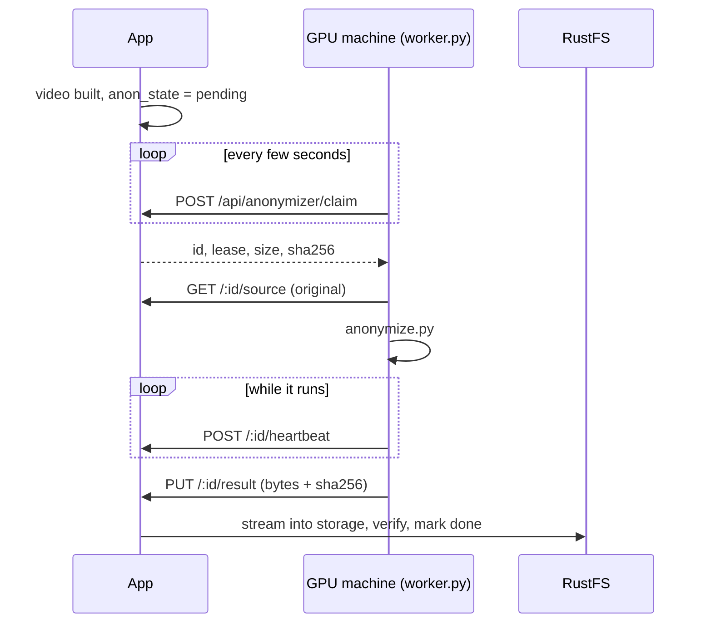

# Anonymizer

Every finished recording gets a second copy with faces and licence plates hidden. The original is kept; field workers download the anonymized copy by default, and admins can reach both.

The detection runs on a separate GPU machine (`video-anonymizer/`, YOLO26 face and plate model), not in the app. The app only keeps the queue and the files.



## Still images

The same GPU machine also makes **still images**, which is what labelling and scoring use. For every built recording it:

1. downloads the original video and the GPS points;
2. picks the sharpest frame in every `SAMPLE_STEP_M` metres walked (`sample_frames.py`; the step is a server setting, default 3 m);
3. hides faces and plates in those frames (`anonymize.py`, face threshold 0.15 because a single image has no neighbour frames to help);
4. for an **inference** assignment, writes GPS and IDs into each image (`tag_gps.py`: EXIF GPS, and an `ImageDescription` with `routeId`, `routeVersionId`, `assignmentId`, `recordingId`, `recordingIndex`, `frame`, `purpose`, `stepM`; nothing about the worker or the device);
5. uploads the images one by one and says it is complete.

**The raw, un-anonymized frames never leave the GPU machine**: they live in a temporary folder that is deleted when the job ends.

An assignment's recordings are one continuous walk: workers are told to start the next recording where the last one stopped, so every later recording is the continuation of the earlier ones. The distance counter and the frame numbers carry on from one recording to the next, so the spacing is the same across a restart. If the worker restarts more than `SAMPLE_GAP_M` metres from where the last recording stopped, something is missing (an unrecorded stretch, or a GPS error): the count still carries on, the jump is not counted as walking, and that image is marked `afterGap` (with `gapM`) so the hole is visible. Recordings are therefore made **in order**: a recording waits until the earlier ones of its assignment are finished.

Each assignment has a **purpose**, chosen when the route is assigned:

| Purpose | Who downloads the images | What is in them |
| --- | --- | --- |
| `training` | the field worker who walked (they label them in CVAT), and admins | pixels only; `frames.json` keeps the GPS for admins |
| `inference` | admins only | GPS and IDs written into every image, plus `frames.json` and `manifest.csv` |

The scoring engine places each image on the route itself, from its GPS and the route version's geometry (`route.json` in the assignment ZIP). The app does not cut the route into scoring units.

**Make images again** (assignment page, `POST /api/admin/assignments/:id/frames/rerun`) deletes the images of all of the assignment's recordings and makes them again, in order, with the current `SAMPLE_STEP_M`. Do this after changing the step or the anonymization mode. Anything already downloaded will not match the new frame numbers; each frame carries its `stepM` so results can be tied to the set they came from.

Run only one kind of job on a machine with `worker.py --kinds frames` or `--kinds video`; the default is both, frames first. `FRAMES_ENABLED=false` stops new recordings being queued for images. Recordings built before this feature are not queued automatically: press **Make images again**.

Image files are PNG (lossless). A 4 minute recording at 3 m is about 90 images and 150 MB.

## Who can download what

| Who | Anonymized | Original |
| --- | --- | --- |
| Field worker | their own recordings, the default | their own recordings, with `?variant=original` |
| Admin | any recording, with `?variant=anonymized` | any recording, the default |
| Anonymizer worker | uploads it | reads it, only while it holds the claim |

The default never falls back to the other file: while the anonymized copy is missing, a worker's default download answers `409 not_anonymized` and the page shows "Hiding faces and plates…". Every download is audited with its variant.

## Setting it up

1. **On the server.** Put a token in `.env` (`npm run init:env` writes one; or `openssl rand -hex 32`) and restart the stack:

   ```
   ANONYMIZER_TOKEN=<at least 32 characters>
   ```

   Without it `/api/anonymizer` answers `404` and nothing is exposed. Recordings still queue as `pending`, so the backlog is processed when you turn it on.

2. **On the GPU machine.** Copy the `video-anonymizer` folder, install its requirements, download the model (see its README), and run the worker:

   ```
   export ANONYMIZER_TOKEN=<the same token>
   python worker.py --server https://your-host.your-tailnet.ts.net
   ```

   Or in Docker, from the `video-anonymizer` folder (GPU needs the NVIDIA driver and `nvidia-container-toolkit` on the Linux host; the `cpu` profile works anywhere but is much slower):

   ```
   ANONYMIZER_TOKEN=<the same token> docker compose --profile gpu up -d --build
   ```

   The worker needs only HTTPS access to the app. It never gets database or storage credentials. Useful options: `--mode pixelgauss|gaussian|pixelate|solid` (default `pixelgauss`; `solid` is the only irreversible one), `--device cuda`, `--once` (process what is waiting, then exit), `--poll 30` (seconds between claims when idle). Run it under `systemd` or `tmux` so it restarts.

3. **Check it.** Record something, wait for the video to build, and watch the admin **Downloads** page: the recording shows "anonymizing…", then an **Anonymized** button. The worker prints each step.

## Failure and recovery

- A job is a lease. The worker's heartbeat keeps it; if the worker crashes or loses the network, the lease runs out after `ANON_LEASE_MINUTES` and the next claim takes the job again. The old worker, if it comes back, is refused (`lease_lost`).
- A failed attempt, or a lease that ran out, uses one of 3 attempts. After the third the recording is `failed`; the last error is in `recordings.anon_error` and in the audit trail (`recording_anonymize_failed`). An admin presses **Retry** on the recording's **Review** page (the API call is `POST /api/admin/recordings/:id/reanonymize`) after fixing the cause.
- A result that does not match its length or SHA-256 is rejected and stores nothing; the worker reports the failure and the job is retried.
- Recordings built before this feature existed were queued by migration `008_anonymize.sql`.
- Images fail and retry the same way (3 attempts, `recordings.frames_error`, audit `recording_frames_failed`). A recording stays `pending` while an earlier one of its assignment is still being made.
- To see the queue: `SELECT anon_state, count(*) FROM recordings GROUP BY 1;` (and `frames_state` for the images) (see [runbook](runbook.md#looking-at-the-data)).

## Speed

On the GTX 1660 Ti the GPU is already about 90% busy while a video runs, so it sets the speed. `worker.py --jobs 2` (Docker: `ANON_JOBS=2`) fills the gaps between and around jobs and helps on faster GPUs; see "Using the GPU and CPU fully" in the anonymizer's own README.

About 2.6 times real time on a GTX 1660 Ti for 1080p footage, one recording at a time. A 10 minute recording takes about 26 minutes. If recordings arrive faster than that, run a second worker on another GPU machine: claims use `FOR UPDATE SKIP LOCKED`, so they never take the same job.

## What it does not promise

- **Detection is not perfect.** On the model authors' test data recall is 0.61 for faces and 0.70 for plates. A face the model misses for longer than the temporal window stays visible. Review anonymized video before publishing it.
- **Audio is dropped** from the anonymized copy (voices identify people). The original keeps its sound.
- **Blur and pixelation are reversible in part.** Use `--mode solid` when that matters.
- **The original is not deleted.** Admins and the worker who recorded it can still download it. If originals must go after anonymization, that is a retention decision still to be made (see the [roadmap](../development/roadmap.md)).
