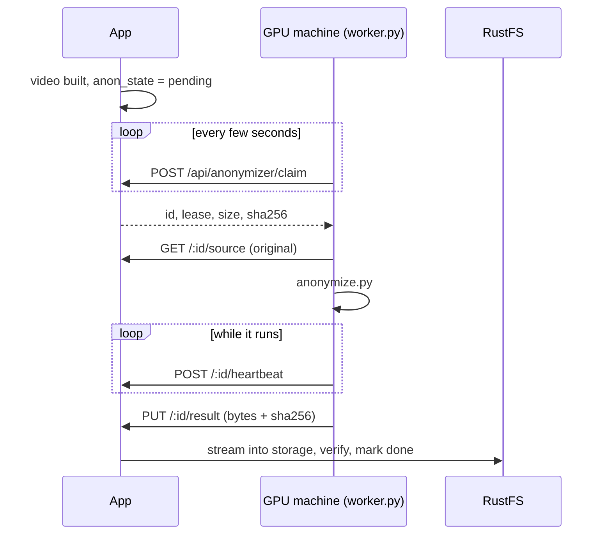

# Anonymizer

Every finished recording gets a second copy with faces and licence plates hidden. The original is kept; field workers download the anonymized copy by default, and admins can reach both.

The detection runs on a separate GPU machine (`video-anonymizer/`, YOLO26 face and plate model), not in the app. The app only keeps the queue and the files.



## Who can download what

| Who | Anonymized | Original |
| --- | --- | --- |
| Field worker | their own recordings, the default | their own recordings, with `?variant=original` |
| Admin | any recording, with `?variant=anonymized` | any recording, the default |
| Anonymizer worker | uploads it | reads it, only while it holds the claim |

The default never falls back to the other file: while the anonymized copy is missing, a worker's default download answers `409 not_anonymized` and the page shows "Hiding faces and plates…". Every download is audited with its variant.

## Setting it up

1. **On the server.** Put a token in `.env` (`npm run init:env` writes one; or `openssl rand -hex 32`) and restart the stack:

   ```
   ANONYMIZER_TOKEN=<at least 32 characters>
   ```

   Without it `/api/anonymizer` answers `404` and nothing is exposed. Recordings still queue as `pending`, so the backlog is processed when you turn it on.

2. **On the GPU machine.** Copy the `video-anonymizer` folder, install its requirements, download the model (see its README), and run the worker:

   ```
   export ANONYMIZER_TOKEN=<the same token>
   python worker.py --server https://your-host.your-tailnet.ts.net
   ```

   Or in Docker, from the `video-anonymizer` folder (GPU needs the NVIDIA driver and `nvidia-container-toolkit` on the Linux host; the `cpu` profile works anywhere but is much slower):

   ```
   ANONYMIZER_TOKEN=<the same token> docker compose --profile gpu up -d --build
   ```

   The worker needs only HTTPS access to the app. It never gets database or storage credentials. Useful options: `--mode solid|gaussian|pixelate` (default `solid`, the only irreversible one), `--device cuda`, `--once` (process what is waiting, then exit), `--poll 30` (seconds between claims when idle). Run it under `systemd` or `tmux` so it restarts.

3. **Check it.** Record something, wait for the video to build, and watch the admin **Downloads** page: the recording shows "anonymizing…", then an **Anonymized** button. The worker prints each step.

## Failure and recovery

- A job is a lease. The worker's heartbeat keeps it; if the worker crashes or loses the network, the lease runs out after `ANON_LEASE_MINUTES` and the next claim takes the job again. The old worker, if it comes back, is refused (`lease_lost`).
- A failed attempt, or a lease that ran out, uses one of 3 attempts. After the third the recording is `failed`; the last error is in `recordings.anon_error` and in the audit trail (`recording_anonymize_failed`). An admin presses **Retry** on the recording's **Review** page (the API call is `POST /api/admin/recordings/:id/reanonymize`) after fixing the cause.
- A result that does not match its length or SHA-256 is rejected and stores nothing; the worker reports the failure and the job is retried.
- Recordings built before this feature existed were queued by migration `008_anonymize.sql`.
- To see the queue: `SELECT anon_state, count(*) FROM recordings GROUP BY 1;` (see [runbook](runbook.md#looking-at-the-data)).

## Speed

On the GTX 1660 Ti the GPU is already about 90% busy while a video runs, so it sets the speed. `worker.py --jobs 2` (Docker: `ANON_JOBS=2`) fills the gaps between and around jobs and helps on faster GPUs; see "Using the GPU and CPU fully" in the anonymizer's own README.

About 2.6 times real time on a GTX 1660 Ti for 1080p footage, one recording at a time. A 10 minute recording takes about 26 minutes. If recordings arrive faster than that, run a second worker on another GPU machine: claims use `FOR UPDATE SKIP LOCKED`, so they never take the same job.

## What it does not promise

- **Detection is not perfect.** On the model authors' test data recall is 0.61 for faces and 0.70 for plates. A face the model misses for longer than the temporal window stays visible. Review anonymized video before publishing it.
- **Audio is dropped** from the anonymized copy (voices identify people). The original keeps its sound.
- **Blur and pixelation are reversible in part.** Use `--mode solid` when that matters.
- **The original is not deleted.** Admins and the worker who recorded it can still download it. If originals must go after anonymization, that is a retention decision still to be made (see the [roadmap](../development/roadmap.md)).
