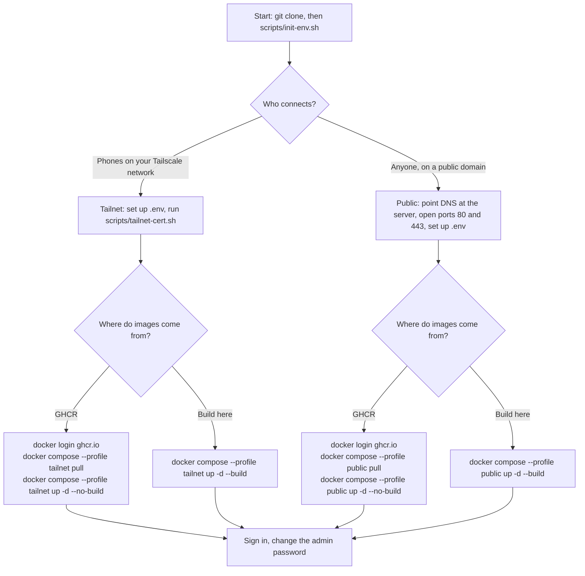

# Deployment

Everything runs with Docker Compose. Pick an edge profile:

| Profile | For | Address | TLS certificate |
| --- | --- | --- | --- |
| `tailnet` | a laptop or server reachable over Tailscale | `https://<machine>.<tailnet>.ts.net` | files made by [`scripts/tailnet-cert.sh`](#the-tailnet-certificate-script) |
| `public` | a VPS with a public IP | `https://<your domain>` | automatic (Let's Encrypt, by Caddy) |

Browsers allow the camera and GPS only on **HTTPS** (or `localhost`), so a phone needs one of these.

Then pick where the images come from:

| Images | For | Needs |
| --- | --- | --- |
| Pull from GHCR | a small server, or any server that should not build | `docker login ghcr.io`, once, with a token that has `read:packages` |
| Build on the machine | a laptop, or running code that is not on `main` | enough memory and time to build |



Pulling still needs the clone: it holds the compose file, the scripts and the Caddy settings. The first-start steps below show the build commands; to use GHCR, swap in the commands from the chart.

## Requirements

- Docker Engine with the Compose plugin (v2).
- For `tailnet`: Tailscale on the machine, with MagicDNS and HTTPS certificates enabled for your tailnet, and on every phone that will connect.
- For `public`: a domain name pointing at the server, ports 80 and 443 reachable.
- Disk: the database is small; plan disk for **video**. At the default 4 Mbps a minute is about 30 MB, so a 25-minute walk is roughly 750 MB. While a recording is being built the server needs about the same again as temporary space inside the container. Add room for backups. (CPU and memory use was not measured; a small VM with 2 vCPU and 2 GB RAM is a reasonable starting point, to be checked against real use.)

## First start (tailnet)

```bash
git clone <repo> field-capture-app && cd field-capture-app
./scripts/init-env.sh     # creates .env and seeds the secrets; asks for a random or your own admin password
```

The script makes `POSTGRES_PASSWORD` (and the copy in `DATABASE_URL`), `S3_ACCESS_KEY`, `S3_SECRET_KEY` and `ADMIN_PASSWORD` long and random. In `.env`:

- `TAILNET_HOST`: your machine's Tailscale DNS name (`tailscale status` shows it; it ends in `.ts.net`). The certificate script below fills it in if it is still the example value.
- `PUBLIC_ORIGINS=https://<TAILNET_HOST>`: the same script adds it (with `:<port>` only if `TAILNET_HTTPS_PORT` is not 443; the origin must match the browser's address bar).
- Leave `COOKIE_SECURE=true` and `TRUST_PROXY=1`.
- `DATABASE_URL` in the example file is only for developing on the host; the containers build their own and ignore it.

Get the certificate. This also fills in `TAILNET_HOST` and `PUBLIC_ORIGINS` ([what the script does](#the-tailnet-certificate-script)):

```bash
./scripts/tailnet-cert.sh
```

Start:

```bash
docker compose --profile tailnet up -d --build
docker compose logs -f app        # expect: migration applied, created bucket, app listening
```

Open `https://<TAILNET_HOST>` and sign in with `ADMIN_USERNAME` and the `ADMIN_PASSWORD` from `.env`. **Change that password** (click your username at the top). Then follow the [admin guide](../guides/admin.md).

Notes:

- The port `443` is published on all interfaces of the machine. To limit it to your Tailscale address, change the `caddy-tailnet` `ports:` line to `"<tailscale-ip>:443:443"`.

## The tailnet certificate script

Caddy on the `tailnet` profile does not get its own certificate. It reads `certs/<TAILNET_HOST>.crt` and `.key`, and `scripts/tailnet-cert.sh` makes those files. Tailscale must be installed and running here, with HTTPS certificates enabled for your tailnet.

| Command | Does |
| --- | --- |
| `./scripts/tailnet-cert.sh` | Gets a certificate, or renews it when fewer than 30 days remain. Otherwise it does nothing, so it is safe to run often. |
| `./scripts/tailnet-cert.sh --force` | Renews even if the current one is still valid. |
| `./scripts/tailnet-cert.sh --install-cron` | Asks, then adds a daily check at 04:17 to your crontab. It logs to `certs/renew.log`. |

Each run also:

- **Finds the host:** `TAILNET_HOST` from the environment or `.env`. If that is empty or still the example value, it uses this machine's name from `tailscale status` and writes it to `.env`.
- **Sets the allowed origin:** adds `https://<host>` to `PUBLIC_ORIGINS`, with `:<TAILNET_HTTPS_PORT>` only if that port is not 443. It drops the example entry and keeps any others.
- **Restarts Caddy** when it writes a new certificate, because Caddy reads the files only at start. If Caddy is not running, it tells you how to start it.

Tailscale certificates last about 90 days, so run `--install-cron` once on any machine that stays up. Without it, HTTPS stops working when the certificate expires. If `tailscale cert` is refused, check that HTTPS is enabled in the admin console (DNS page), and that you may run it (try `sudo`). The `certs/` folder holds the private key and is not committed.

This applies whether you pull images from GHCR or build them: the certificate stays on the machine, never in an image.

## First start (public VPS)

1. Point your domain's DNS (`A` and, if you have it, `AAAA`) at the server.
2. Open only what is needed on the host firewall: SSH, 80, 443.
3. Install Docker, clone the repository, `./scripts/init-env.sh`, then edit `.env`:
   - the four secrets are already seeded;
   - `DOMAIN=<your domain>`;
   - `PUBLIC_ORIGINS=https://<your domain>` (**remove** any `localhost` entry);
   - `COOKIE_SECURE=true`, `TRUST_PROXY=1`.
4. Start **without** the dev override:

```bash
docker compose --profile public up -d --build
docker compose logs -f caddy-public     # watch it obtain the certificate
```

5. Open `https://<your domain>`, sign in as the admin, change the password.

**Important on a public server**

- Never use `docker-compose.dev.yml` there: it publishes the database and storage, and turns on dev tools.
- Docker-published ports bypass `ufw`. The main compose file publishes only Caddy's ports; keep it that way.
- Work through the [security checklist](../reference/security.md#before-going-public-checklist) before inviting workers.
- Replace the free map tile servers with a provider you have an account with ([roadmap](../development/roadmap.md)).

## Updating

CI publishes the images to GHCR after the tests pass on `main`, for `linux/amd64` and `linux/arm64`, so a server does not have to build anything:

| Image | Tags |
| --- | --- |
| `ghcr.io/ai-ldcs/field-capture-app` | `latest`, `sha-<commit>` |
| `ghcr.io/ai-ldcs/field-capture-db` | `latest`, `sha-<commit>` |

The images are private. Log in once on each server, with a GitHub token that only has `read:packages`:

```bash
docker login ghcr.io -u <github-user>
```

Back up first if the update adds a migration; the app applies it when it starts. Then:

```bash
git pull                                                # compose file and Caddy settings
docker compose --profile <tailnet|public> pull
docker compose --profile <tailnet|public> up -d --no-build
docker compose logs --tail 20 app                       # look for "migration applied"
```

To go back to an older version, or stay on one, set `IMAGE_TAG=sha-<commit>` in `.env` and run the same `pull` and `up` commands. The commit's short SHA is on its CI run. **This does not undo a migration**: if one ran since that version, restore the [backup](runbook.md#backup-and-restore) taken before it. Check for a Postgres major version change too, and follow the [migration plan](database-migration.md#major-version-upgrade) if there is one.

To build on the machine instead, as on a laptop, use `docker compose --profile <tailnet|public> up -d --build`.

## What starts, and in what order

`db` (waits until healthy) → `rustfs` → `app` → the edge proxy. The app, on start: checks config, applies migrations, creates the first admin if none exists, creates the storage bucket if missing, starts the video assembler, then listens.

## Volumes

| Volume (project `field-capture`) | Holds |
| --- | --- |
| `field-capture_pgdata` | the database |
| `field-capture_rustfs-data` | all video |
| `field-capture_caddy-data-tailnet` / `-public` | Caddy's state (certificates for the public profile) |

`docker compose down` keeps them; `docker compose down -v` **deletes everything**.

## Development on a laptop

```bash
./scripts/init-env.sh     # the example already points the host app at 127.0.0.1:5433 and :9000
docker compose -f docker-compose.yml -f docker-compose.dev.yml up -d db rustfs
npm install
npm run dev              # http://localhost:3100, plain http, dev tools on
```

For a phone you need HTTPS: either use the `tailnet` profile against your laptop, or run the full stack in Docker with the dev override (`docker compose -f docker-compose.yml -f docker-compose.dev.yml --profile tailnet up -d --build`).
